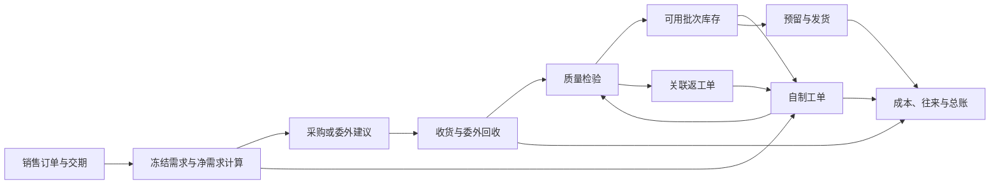

# 业务架构与接口

## 单据流与过账



集团主档共享物料身份，各法人保留供应策略、库存、会计期间与账簿。请求从会话确定经办人和当前法人。单据写入锁定法人并重新验证权限。跨法人调拨按一致顺序锁定两边，然后在同一事务保存源批次扣减、目标批次入库和双方凭证。

单据基准日选择 BOM、工艺和单位换算版本。工单创建时保存 BOM、工艺版本及标准用料、工时快照。收货和入库保存用量、交易单位及其换算率。试算保存按需用日期冲抵的来源、短缺、建议以及与上次的差异，供批准后转成单据。

件数按千分之一单位保存，钱款按本位币的百分之一保存。业务表单接收十进制数量和金额，数据库和导出使用字段后缀 `_milli` 和 `_minor` 标识整数比例。单工单按原领料追踪实际成本，累计分摊使多批完工合计回到工单总费用。关账快照重算应收应付、在制成本、借贷平衡和跨法人匹配。

库存通过批号和库位流水区分待检、可用、拒收与返工。合格批次才能用于交付，出库行引用库存分配。批次谱系连接投入、成品与返工批次，下游追溯查得到受影响的交付与客户。

## 主要模块

| 层 | 入口 |
| --- | --- |
| HTTP、会话与表单 | `public/index.php`、`WebApp`、`WebSession`、`WebOperations` |
| 组织、工程与计划 | `Identity`、`MasterData`、`ProductEngineering`、`Planning` |
| 采购、质量与库存 | `Sourcing`、`Purchasing`、`Inspection`、`Inventory`、`Genealogy` |
| 销售与生产执行 | `Sales`、`Shipping`、`WorkOrders`、`Scheduling`、`Completion`、`Subcontracting` |
| 财务 | `GeneralLedger`、`ReceivablesPayables`、`Intercompany`、`FiscalClose` |
| 批量与运维 | `BatchJobs`、`BatchWorker`、`Exports`、`Migrations`、`bin/erp.php` |

## 同站 HTTP 接口

HTTP 运行在同一个站点根路径。设置 `Accept: application/json` 或 `format=json` 获取 JSON。请求先读取 `GET /?page=session` 取得 Cookie 与初始 `csrf`，再提交登录。登录与切换法人都会轮换 Cookie 和令牌。后续写操作携带新 Cookie 以及 `X-CSRF-Token`，或使用页面表单的 `_csrf`。

| 入口 | 用途 |
| --- | --- |
| `POST /?action=login` | 输入 `email`、`password`，返回当前法人、可切换法人和岗位 |
| `POST /?action=switch-org` | 输入 `org_id`，切换到已授权法人 |
| `GET /?page=planning&id=…` | 试算明细、短缺和重算差异。用 `ref` 查询单行来源 |
| `POST /?action=calculate-plan` | 输入 `request_key`、`as_of`、`horizon_on` 和可选的 `policy`，返回 HTTP 202 与任务号 |
| `GET /?page=jobs&id=…` | 查看任务行、失败原因及重试历史 |
| `POST /?action=issue-material` | 输入 `request_key`、`material`、`lot`、`location`、`quantity` 和 `posted_on`，可指定 `replacement`、`overage` 授权 |
| `GET /?page=receipt&operation=…&request_key=…` | 原经办人查询当前法人中的持久回执，如 `work.issue` 或 `jobs.enqueue` |
| `GET /?page=export&kind=…` | 下载 CSV。支持 `work-issues`、`lot-trace`、`work-variance`、`receivables`、`payables`、`journals` |

试算内置策略标识为 `dated-netting-v1`。下例提交一份试算并返回后台任务。示例假定 Cookie 文件和令牌已从登录响应中获取。

```sh
curl --fail --cookie cookies.txt -H 'Accept: application/json' \
  -H 'Content-Type: application/json' -H "X-CSRF-Token: $erp_csrf" \
  --data '{"request_key":"factory-mrp-20370601-01","as_of":"2037-06-01","horizon_on":"2037-06-15","policy":"dated-netting-v1"}' \
  'http://127.0.0.1:8080/?action=calculate-plan'
```

对已完成并持久化的操作，原经办人使用相同请求标识和内容重试会得到原结果。同一法人、同一操作的请求标识只能归属于一次提交。检验判定还携带记录版本，版本冲突时重新读单据。常见错误为 401 会话失效、403 权限或令牌校验失败、404 对象在当前范围内不可见、409 状态冲突、422 字段或业务校验失败。扩展版本缺失或健康检查未通过时返回 503。典型录入、发货与关账请求可参考 [HTTP 回归用例](../tests/http-workspace.php)。

业务过账和回执在同一事务提交。批量任务的执行、重试和取消按行保存，已完成的行继续生效。CSV 使用 UTF-8 BOM，并处理可能被表格软件误识别为公式的文本。
